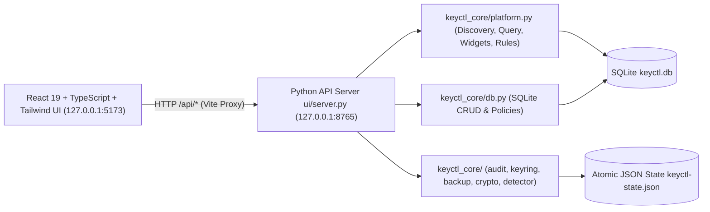
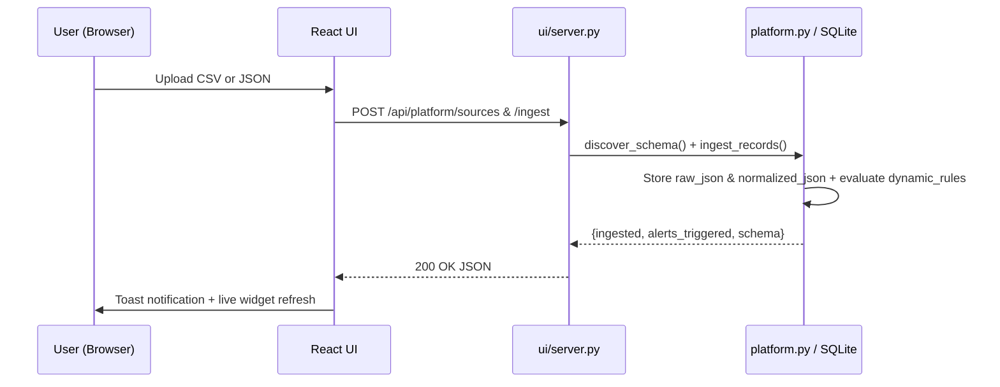

# KeyCTL

A local-first, schema-agnostic data ingestion, querying, and security operations platform built with Python, SQLite, and React.

---

## Table of Contents

1. [Project Overview](#1-project-overview)
2. [Problem Statement](#2-problem-statement)
3. [Core Features](#3-core-features)
4. [System Architecture](#4-system-architecture)
5. [Complete Data Flow](#5-complete-data-flow)
6. [Data Ingestion & Schema Discovery](#6-data-ingestion--schema-discovery)
7. [Database & Persistence](#7-database--persistence)
8. [Dashboard & Visualization Engine](#8-dashboard-and-visualization-engine)
9. [Real-Time Synchronization](#9-real-time-synchronization)
10. [Monitoring, Rules & Alerts](#10-monitoring-rules--alerts)
11. [Security & Reliability](#11-security-and-reliability)
12. [Technology Stack](#12-technology-stack)
13. [Repository Structure](#13-repository-structure)
14. [Installation & Setup](#14-installation--setup)
15. [Environment Variables](#15-environment-variables)
16. [API Reference](#16-api-reference)
17. [Testing & Verification](#17-testing--verification)
18. [Current Limitations & Future Work](#18-current-limitations--future-work)

---

## 1. Project Overview

Traditional dashboards hardcode schemas, metrics, and sample datasets. KeyCTL inverts that model:

- **Schema-Agnostic Ingestion**: Upload any CSV or JSON dataset. KeyCTL samples records, infers field types (`integer`, `number`, `boolean`, `timestamp`, `string`, `object`), detects nullable fields, and preserves both raw and normalized records.
- **Persistent SQLite Storage**: All sources, records, field mappings, custom dashboard widgets, identities, assets, policies, monitoring rules, and alerts are stored in SQLite (`keyctl.db`) and survive restarts.
- **Dynamic Query & Widget Engine**: Users build custom metric cards and grouped aggregations (`count`, `sum`, `avg`, `min`, `max`, `distinct_count`) against any connected source without writing SQL or modifying source code.
- **Configurable Monitoring & Notifications**: Users define threshold/condition rules (`eq`, `neq`, `contains`, `gt`, `lt`) on any field; matching records trigger persisted alerts and deduplicated toast notifications.
- **Security Core**: Includes deny-by-default access control, `fcntl.flock` + atomic `os.replace()` state persistence, SHA-256 hash-chained audit logs, integrity-protected backup/restore, versioned key rotation, and optional ML-KEM-768 `protected_read` (`pqcrypto==0.4.0`).

---

## 2. Problem Statement

Static monitoring dashboards break as soon as an organization's data format changes. KeyCTL solves this by separating **ingestion and schema discovery** from **storage, querying, and visualization**, allowing any dataset structure to be explored, monitored, and visualized immediately.

---

## 3. Core Features

| Feature | Implementation | Status |
|---|---|---|
| **Dynamic Source Management** | `keyctl_core/platform.py` (`create_source`, `list_sources`) | Implemented & tested |
| **Automatic Schema Discovery** | `keyctl_core/platform.py` (`discover_schema`) | Implemented & tested |
| **Flexible Raw + Normalized Storage** | `keyctl_core/platform.py` (`ingest_records`, `dynamic_records` table) | Implemented & tested |
| **Dynamic Query & Aggregation Engine** | `keyctl_core/platform.py` (`query_records`) | Implemented & tested |
| **Custom Dashboard Widget Builder** | `ui/src/pages/CustomDashboardPage.tsx`, `platform.py` (`save_widget`) | Implemented & tested |
| **Dynamic Monitoring Rules & Alerts** | `keyctl_core/platform.py` (`create_dynamic_rule`, `list_dynamic_alerts`) | Implemented & tested |
| **Identity, Asset & Policy CRUD** | `keyctl_core/db.py`, `ui/src/pages/LiveCorePages.tsx` | Implemented & tested |
| **Global Toast Notification System** | `ui/src/contexts/ToastContext.tsx`, `ui/src/hooks/useToast.ts` | Implemented & tested |
| **Tamper-Evident Audit Chain** | `keyctl_core/audit.py` (`verify_audit_chain`) | Implemented & tested |
| **Key Lifecycle & ML-KEM-768** | `keyctl_core/keyring.py`, `keyctl_core/crypto.py` | Implemented (`pqcrypto==0.4.0` tested in Python 3.12 Docker) |

---

## 4. System Architecture



---

## 5. Complete Data Flow



---

## 6. Data Ingestion & Schema Discovery

- **CSV & JSON**: `ui/src/pages/DataIngestionPage.tsx` parses CSV or JSON arrays/objects, previews records, allows field mapping, and commits to SQLite.
- **Schema Discovery**: `discover_schema(records)` samples up to 50 records, infers `integer`, `number`, `boolean`, `timestamp`, `string`, or `object`, and flags nullable fields.
- **Provenance**: Every record retains `raw_json`, `normalized_json`, `source_id`, and `ingested_at`.

---

## 7. Database & Persistence

SQLite (`keyctl.db` in `TRACK4_STATE_DIR` or OS temp directory) stores:
- `data_sources`, `dynamic_records`, `dashboard_widgets`, `dynamic_rules`, `dynamic_alerts`
- `identities`, `assets`, `policies`, `monitoring_rules`, `alerts`, `imports`

All queries use parameterized `sqlite3` statements.

---

## 8. Dashboard and Visualization Engine

`CustomDashboardPage.tsx` lets users add metric widgets backed by `/api/platform/query` (`count`, `sum`, `avg`, `min`, `max`, `distinct_count`, `group_by`). Empty databases render clean empty states rather than fabricated metrics.

---

## 9. Real-Time Synchronization

`useLiveKeyctlState.ts` polls `/api/overview` every 2.5 seconds with non-overlapping request guards (`inFlightRef`), emits connection-lost/restored toasts, and deduplicates new audit events by sequence number.

---

## 10. Monitoring, Rules & Alerts

Users create rules on any `source_id` + `field` + `condition` (`eq`, `neq`, `contains`, `gt`, `lt`) + `value` + `severity`. Rules are evaluated on ingestion and persist alerts to `dynamic_alerts` with exact `record_id` references.

---

## 11. Security & Reliability

- `ui/server.py` binds exclusively to `127.0.0.1` and never exposes private keys, shared secrets, or tracebacks.
- `keyctl_core/store.py` uses `fcntl.flock` + `os.fsync()` + `os.replace()` for crash-safe atomic writes.
- **Limitations**: `keyctl-state.json` is unencrypted JSON; `audit_chain` uses unkeyed SHA-256; `NodeCluster` and `OrderedChannel` are in-process simulations.

---

## 12. Technology Stack

| Layer | Technology |
|---|---|
| Frontend | React 19, TypeScript, Vite 6, Tailwind CSS 4, Lucide React, Recharts |
| Frontend Testing | Vitest, React Testing Library |
| Backend | Python 3.12+, stdlib `http.server`, `sqlite3`, `fcntl`, `hmac`, `hashlib` |
| Post-Quantum Crypto | `pqcrypto==0.4.0` (ML-KEM-768) |

---

## 13. Repository Structure

```text
keyctl/
├── keyctl_core/          # Core engine (platform.py, db.py, store.py, policy.py, audit.py, crypto.py, keyring.py, backup.py, cluster.py, messaging.py, detector.py)
├── ui/                   # React + TypeScript + Vite dashboard & local API server (ui/server.py)
├── tests/                # Backend unit & adversarial tests
├── docs/                 # Technical documentation
├── practice/             # Sample labelled event dataset
├── track4_service.py     # CLI JSON adapter
├── team_app.py           # Adapter dispatch router
├── requirements.txt      # Python dependencies (pqcrypto==0.4.0)
└── pyproject.toml        # Project metadata (Python 3.12)
```

---

## 14. Installation & Setup

### Backend
```bash
python3.12 -m venv .venv312
source .venv312/bin/activate
pip install -r requirements.txt
python3 ui/server.py
```

### Frontend
```bash
cd ui
npm install
npm run dev
```

Open `http://127.0.0.1:5173`.

---

## 15. Environment Variables

| Variable | Purpose | Required | Default |
|---|---|---|---|
| `TRACK4_STATE_DIR` | Directory for `keyctl.db` and `keyctl-state.json` | No | OS temp directory |
| `KEYCTL_UI_PORT` | Port for `ui/server.py` | No | `8765` |

---

## 16. API Reference

- `GET /api/health` — Server & `pqcrypto` availability
- `GET /api/overview` — Live state, `audit_chain`, and SQLite summaries
- `GET/POST /api/identities`, `POST /api/identities/revoke` — Identity CRUD
- `GET/POST /api/assets`, `GET/POST /api/policies`, `POST /api/policies/evaluate` — Asset & policy CRUD
- `GET/POST /api/platform/sources`, `POST /api/platform/discover`, `POST /api/platform/ingest`, `POST /api/platform/query` — Dynamic ingestion & query engine
- `GET/POST /api/platform/widgets`, `POST /api/platform/rules`, `GET /api/platform/alerts` — Custom widgets & monitoring rules
- `POST /api/keys/rotate`, `POST /api/audit/verify`, `POST /api/backup/demo` — Key lifecycle, audit verification, backup check

---

## 17. Testing & Verification

```bash
# Backend unit tests
python3 -m unittest discover -s tests -v

# Frontend tests & production build
cd ui && npm run test && npm run build
```

---

## 18. Current Limitations & Future Work

- `pqcrypto==0.4.0` requires Python 3.12 (verified in `python:3.12-slim` Docker).
- `NodeCluster` and `OrderedChannel` are in-process simulations.
- Future work: PostgreSQL adapter, SSE push stream for `dynamic_alerts`, and encrypted-at-rest SQLite/JSON storage.
